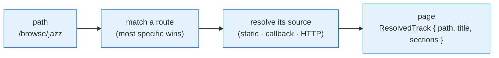

# Browser

The **Browser** is the subsystem that turns one declarative description of your content into a navigable tree — the same tree that powers your in-app browse UI, CarPlay, and Android Auto.

You describe it once with **`configureBrowser`**; the library resolves paths, fetches children, transforms requests, and renders the native surfaces for you.

[Basic Usage](/guide/basic-usage) introduces the browse tree. This guide is the reference for _configuring_ it: every source shape, every routing pattern, and every option on [`BrowserConfiguration`](/api/types/browser/#browserconfiguration).

## A complete example

Here is a full, runnable configuration — call `setupPlayer` once, then `configureBrowser` once. It has two tabs, two **static** routes, and one **callback** route. Paste it, swap in your own content, and you have a working browse tree on phone, CarPlay, and Android Auto.

```ts
import { setupPlayer, configureBrowser } from 'react-native-audio-browser'

await setupPlayer()

configureBrowser({
  tabs: [
    { title: 'Browse', path: '/browse' },
    { title: 'Favorites', path: '/favorites' }
  ],
  routes: {
    // Static data declared inline:
    '/browse': {
      path: '/browse',
      title: 'Browse',
      children: [
        // browsable — has a path
        { title: 'Jazz', path: '/browse/jazz' },
        // playable — has a src
        { title: 'Smooth Floret FM', src: 'https://example.com/floret.mp3' }
      ]
    },
    // Resolved on demand from your own code:
    '/browse/jazz': async () => {
      const stations = await fetchJazzStations() // your code
      return { path: '/browse/jazz', title: 'Jazz', children: stations }
    },
    '/favorites': {
      path: '/favorites',
      title: 'Favorites',
      children: [
        { title: 'Smooth Floret FM', src: 'https://example.com/floret.mp3' }
      ]
    }
  }
})
```

::: tip "Your code" vs. library API
Helpers like `fetchJazzStations`, `fetchAlbum`, `getLocalFavoriteIds`, and `getDomain` throughout this guide are **your** functions, not library exports — they stand in for however your app gets its data. Only imports from `react-native-audio-browser` are library API.
:::

Calling `configureBrowser` again **replaces** the entire configuration — see [Updating the configuration](#updating-the-configuration). The rest of this guide unpacks each part.

## How a path resolves

Everything the Browser shows is the result of resolving a **path** (a string like `/browse/jazz`) to a **page** — a Track carrying its content. The flow is always the same:



A **page** is a [`ResolvedTrack`](/api/types/browser-nodes/#resolvedtrack): it requires a `path` and a `title`, and carries its content as `sections` — an array of [`Section`](/api/types/browser-nodes/#section)s, each a titled, styled group of [`Track`](/api/types/browser-nodes/#track)s:

```ts
{
  path: '/home',
  title: 'Home',
  sections: [
    {
      title: 'Popular',
      style: { display: 'grid', gridWrap: false },
      path: '/popular',
      children: [...]
    },
    { title: 'All stations', children: [...] }
  ]
}
```

A Section is `{ title?, style?, path?, children }`. `title` renders as a header above its tracks. `style` is a declaration block whose `display` picks the children's layout: `'list'` rows (the default) or `'grid'` artwork tiles, with `gridWrap: false` keeping the grid to a single line.

`path` is the navigation target for the section's "view all" affordance.

See [Presentation](#presentation) for how each surface renders the declarations.

A flat page doesn't have to spell that out: authoring a plain `children: Track[]` — as most examples in this guide do — is sugar for one untitled section. Resolved output always carries `sections`; `children` is never populated on a resolved page.

So configuring the Browser is really three decisions, covered in turn below: **what routes exist**, **what source each route resolves from**, and **how requests are shaped** along the way.

## Source shapes

Wherever the Browser needs content — a route, the `tabs`, `search` — you supply a **source**. A route's source is one of three shapes: static data, a callback, or an HTTP endpoint.

### 1. Static data

A page object you declare inline. Best for small, fixed trees.

```ts
configureBrowser({
  routes: {
    '/browse': {
      path: '/browse',
      title: 'Browse',
      children: [
        // browsable — has a path
        { title: 'Jazz', path: '/browse/jazz' },
        // playable — has a src
        { title: 'Smooth Floret FM', src: 'https://example.com/floret.mp3' }
      ]
    }
  }
})
```

### 2. A callback

A function `({ path, routeParams }) => ResolvedTrack` (sync or async). Resolve children from anywhere — memory, a database, your own fetch logic. Best for trees too large to declare upfront, or content that depends on runtime state.

```ts
configureBrowser({
  routes: {
    '/albums/{id}': async ({ routeParams }) => {
      const album = await fetchAlbum(routeParams?.id) // your code
      return {
        path: `/albums/${album.id}`,
        title: album.name,
        children: album.tracks
      }
    }
  }
})
```

Return `{ error: 'message' }` instead of a page to signal a failure the Browser should surface — see [Error handling](#error-handling).

### 3. An HTTP endpoint

A [`TransformableRequestConfig`](/api/types/browser/#transformablerequestconfig). The library issues the request **natively** (so browse works on a cold car start with your JS not yet running) and expects a page object — a `ResolvedTrack` — back.

The key convenience: with a `baseUrl` set, **any path with no explicit route is fetched over HTTP automatically** — the navigated path becomes the request path. So a fully server-driven tree may need _no_ `routes` at all:

```ts
configureBrowser({
  // GET https://api.example.com/browse/jazz
  // (the navigated path flows through automatically)
  request: { baseUrl: 'https://api.example.com' }
})
```

::: warning A static `path` does not rewrite the request path
On an HTTP route, the _navigated_ path is used as the request path — a static `path` field is ignored for this. To remap (e.g. send `/favorites` to `/favorites/v2`), use a [transform](#transforms-per-request), which also receives `routeParams`.
:::

::: tip Tabs and search
`tabs` accepts the same three shapes, but its static form and its callback give a `Track[]`, not a page. `search` accepts a callback or an HTTP endpoint, with no static form. Its callback receives the search params and returns a `Track[]`:

```ts
configureBrowser({
  search: async ({ query }) => searchStations(query) // your code → Track[]
})
```

Search has its own depth (voice intents, query modes) — see [Search](/guide/search).
:::

## Tabs and the initial path

`tabs` are the top-level entry points — the segmented control in your app, the tab bar on CarPlay, the root of the Android Auto tree. Each tab is a Track with a `title` and a `path` pointing at a route.

```ts
configureBrowser({
  tabs: [
    { title: 'Home', path: '/home' },
    { title: 'Favorites', path: '/favorites' },
    { title: 'Browse', path: '/browse' }
  ]
})
```

::: warning Car surfaces show only the first few tabs
Android Auto shows the first **4** tabs. CarPlay shows as many as `CPTabBarTemplate.maximumTabCount` allows. Only those surfaces hide the extra tabs: `getTabs` and `useTabs` return every tab. A debug build warns when a static `tabs` array has more tabs than Android Auto shows.
:::

::: tip A tab's path stays a tab
Link freely to a tab's own path — a "view all" section header on one tab pointing at another tab's route, say. On CarPlay (iOS 17+) that **switches to the tab** instead of pushing a second copy of it onto the current tab's stack.

The user lands where the tab bar already shows that content, with no Back button to a page they never came from. Elsewhere — earlier iOS, Android Auto, your app UI — it navigates as usual.
:::

Like any source, `tabs` can also be a **callback** — useful when the tabs themselves depend on runtime state, such as a debug build or the current user:

```ts
configureBrowser({
  tabs: () => [
    { title: 'Home', path: '/home' },
    { title: 'Favorites', path: '/favorites' },
    ...(__DEV__ ? [{ title: 'Debug', path: '/debug' }] : [])
  ]
})
```

…or an **HTTP endpoint** returning a page (`{ children: Track[] }`).

**Initial path.** The Browser opens to the first tab's `path` by default. Set `path` to start somewhere else:

```ts
configureBrowser({
  // where browse opens; defaults to the first tab's path (or '/')
  path: '/home',
  tabs: [
    /* … */
  ]
})
```

## Routes

`routes` maps **path patterns** to sources. When the Browser resolves a path, it finds the matching pattern and resolves that pattern's source.

### Pattern syntax

Patterns match on **exact segment count** first — `/artists` does _not_ match `/artists/123`. Within that, a segment can be:

| Pattern        | Matches                                                   | Captured           |
| -------------- | --------------------------------------------------------- | ------------------ |
| `/favorites`   | exactly `/favorites`                                      | —                  |
| `/albums/{id}` | `/albums/floret`, `/albums/42`                            | `routeParams.id`   |
| `/artists/*`   | any single segment at that position (`/artists/anything`) | —                  |
| `/files/**`    | `/files` itself, and `/files/...` at any depth below      | `routeParams.tail` |

On `/files` itself, `routeParams.tail` is `undefined`.

When several patterns match, **most specific wins**: constant > `{param}` > `*` > `**`. So `/albums/new` and `/albums/{id}` can coexist — `/albums/new` takes the literal route.

```ts
configureBrowser({
  routes: {
    // literal — checked first
    '/albums/new': newReleasesPage,
    // {id} otherwise
    '/albums/{id}': ({ routeParams }) => fetchAlbum(routeParams?.id),
    // deep file paths
    '/files/**': ({ routeParams }) => listFiles(routeParams?.tail)
  }
})
```

::: warning The bare `'*'` key is the _default_, not a wildcard segment
A single-segment wildcard only works as a `*` **segment inside a longer pattern** (e.g. `/artists/*`).

The bare top-level key `'*'` is different: it's the **custom default** — the source used for any path no other route matches (and only needed if you want to override the built-in HTTP default).

```ts
routes: {
  // wildcard segment — matches /artists/<one segment>
  '/artists/*': handleArtist,
  // default for everything unmatched
  '*': { baseUrl: 'https://api.example.com' }
}
```

:::

### Route parameters

A callback (or transform) receives the captured params in `routeParams`:

```ts
'/stations/{country}/{city}': async ({ routeParams }) => {
  // /stations/nl/amsterdam → { country: 'nl', city: 'amsterdam' }
  return fetchStations(routeParams?.country, routeParams?.city)
}
```

### Per-route overrides

A route value can be a bare source (the common case) **or** a [`RouteConfig`](/api/types/browser/#routeconfig) object that overrides request behavior for just that subtree — its `browse` source, plus its own `artwork` config. The web ignores a route's `artwork` and uses the top-level `artwork` config.

```ts
configureBrowser({
  routes: {
    '/premium/**': {
      browse: { baseUrl: 'https://premium-api.example.com' },
      artwork: { baseUrl: 'https://premium-images.cdn.example.com' }
    }
  }
})
```

This is how you point one branch of the tree at a different backend without touching the rest.

## Shaping requests

For HTTP sources, you rarely repeat the same `baseUrl`, headers, and query params on every route. Instead you set them once and let them **layer**. From most general to most specific:

```
request   →   browse   →   route
(all kinds)   (browse only)   (this route only)
```

`request` also feeds `media`, `artwork`, and `search`; `browse` narrows to browse requests; a route's own config wins last.

```ts
configureBrowser({
  request: { baseUrl: 'https://api.example.com', headers: { 'x-app': 'demo' } },
  browse: { query: { client: 'audio-browser', hl: 'en' } },
  routes: {
    // adds genre=jazz on top of the request and browse layers;
    // the navigated path is the request path
    '/browse/jazz': { query: { genre: 'jazz' } }
  }
})
```

A path that needs nothing extra needs no route at all: an unmatched path is fetched through `request` and `browse`. An empty route object (`{}`) is not a request config: it is read as a static page with no `path` or `title`. On iOS and Android `configureBrowser` throws on it, on web it renders a blank page, and a debug build warns about it.

### RequestConfig fields

Every request layer is a [`RequestConfig`](/api/types/browser/#requestconfig) — set only the fields you need. Headers and query params merge key by key; other fields override:

| Field                  | Purpose                                                                              |
| ---------------------- | ------------------------------------------------------------------------------------ |
| `baseUrl` / `path`     | Where to send the request (note: `path` doesn't override the navigated browse path)  |
| `method`               | `GET` (default), `POST`, …                                                           |
| `headers`              | HTTP headers (merged key by key)                                                     |
| `query`                | Query parameters (merged key by key)                                                 |
| `body` / `contentType` | Request body, sent for `POST`, `PUT` and `PATCH` (and `DELETE` when set); not on web |
| `userAgent`            | `User-Agent` override (a `User-Agent` in `headers` wins on iOS); ignored on web      |

### Transforms: per request

When a layer needs to change _per request_ (read the captured `routeParams`, switch a `GET` to a `POST`, remap the path), add a `transform` (async) or `transformSync`. It receives the merged request and returns the final one:

::: warning A transform replaces — it doesn't merge
Your return value **becomes** the request; the layer's own static fields are _not_ merged back in. Always **spread the incoming `request`** (`{ ...request, … }`) — a transform that returns a bare `{ method: 'POST' }` silently drops the inherited `baseUrl`, `headers`, and `query`.
:::

```ts
configureBrowser({
  routes: {
    '/favorites': {
      // turn the favorites browse into a POST carrying locally-stored ids
      transformSync: (request) => ({
        ...request,
        method: 'POST',
        // remapping the path is valid here, in a transform
        path: '/favorites/v2',
        contentType: 'application/json',
        body: JSON.stringify({ ids: getLocalFavoriteIds() }) // your code
      })
    }
  }
})
```

### Resolvers: values that change rarely

When the _whole_ config depends on runtime state — a domain that varies by environment, a locale, an auth host — make the layer a **resolver**: a thunk returning the config.

It runs **once per content generation** and is cached until you call [`invalidateAllContent`](#updating-the-configuration), so it's the cheap place to read values that change rarely:

```ts
configureBrowser({
  // re-evaluated only when content is regenerated, not per request
  request: () => ({
    baseUrl: `https://${getDomain()}/api`, // your code
    userAgent: resolveUserAgent() // your code
  }),
  browse: () => ({ query: { hl: resolveLocale() } }) // your code
})
```

::: tip Resolver vs. transform
**Resolver** (the layer _is_ a function): runs once, cached — for values that change rarely. **Transform** (a `transform` field _on_ the layer): runs every request — for per-request shaping. Reach for a resolver first; add a transform only when a single request genuinely differs.
:::

## Media and artwork

The same request machinery shapes the **audio stream** request (`media`) and **image** requests (`artwork`). Both layer on top of `request`, and both add a per-track `resolve` / `resolveSync` so a single track can build its own stream or image request from its metadata:

```ts
configureBrowser({
  media: {
    // build the stream request per track — e.g. a signed URL
    resolve: async (track) => ({
      path: `/stream/${track.id}`,
      query: { token: await sign(track.id) }
    })
  },
  artwork: {
    baseUrl: 'https://images.example.com',
    // tell the library which query params carry the requested size
    imageQueryParams: { width: 'w', height: 'h' }
  }
})
```

With `imageQueryParams`, CarPlay and Android Auto's requested size is injected automatically (`?w=200&h=200`) so each surface gets right-sized art. For full control, an `artwork.transform` receives that size as an [`ImageContext`](/api/types/browser/#imagecontext).

**Now-playing art** can differ from browse-row art — set `nowPlayingArtwork` for the lock screen / car now-playing surface only. Like `artwork`, it can use an `{id}` template filled from the active track's `id`:

```ts
// {id} templating (in any artwork config) is native-only:
// the web implementation does not apply it
configureBrowser({
  // {id} → the active track's id
  nowPlayingArtwork: { path: '/artwork/{id}' }
})
```

See [Now Playing](/guide/now-playing) for the metadata side of the now-playing surface.

## Playback behavior

Two options control what happens when a playable Track is tapped.

**`singleTrack`** — by default, tapping a track queues **its section** and starts there, so next/previous walk the list the user tapped in.

The scope is the page's declared structure: the tapped [Section](#how-a-path-resolves)'s `children`, identical on every surface (a page authored with plain `children` is one untitled section). Rendering may truncate what a section _shows_ — a CarPlay single-line grid fits only so many tiles — but never what _plays_.

A page aggregating several sections never leaks next/previous across them. Set `singleTrack: true` to play only the tapped track. If the track has meanwhile disappeared from its section (a stale resume, say), the library plays it as a single track rather than guessing a queue from the changed list.

Section scoping knows _where_ the tap happened, not just on what. Each playable row's path carries the track's identity (`id`, falling back to `src`) and the row's position on the page.

So the same track can safely appear in several places on one page: a tap queues the section it happened in, and when a playlist holds the same track twice, next/previous continue from the tapped copy.

The position is only a tie-breaker. If the page has changed by the time the queue is expanded (a stale resume, say), the first row matching the identity wins instead — a stale position can pick a different copy of the tapped track, never a different track.

Tapping a row that's already in the current queue from the same page skips in place rather than requeueing the section.

**`handleTrackLoad`** — intercept loading entirely. When set, tapping a track calls _your_ handler **instead of** the library auto-playing, and native waits for your promise to resolve before continuing. The two branches differ:

```ts
import { configureBrowser, setQueue, play } from 'react-native-audio-browser'

configureBrowser({
  handleTrackLoad: async ({ track, queue, startIndex, startPosition }) => {
    if (isVideo(track)) {
      // your surface — return without touching the player; audio stays put
      openVideoPlayer(track)
      return
    }
    // audio: drive playback yourself — the library won't auto-play
    setQueue(queue, startIndex, startPosition)
    play()
  }
})
```

In the video branch, returning without calling the player tells the library the tap is handled and audio stays as it is. In the audio branch, call [`setQueue` and `play`](/guide/basic-usage) yourself. Both return `void`, so there is nothing to await on them.

Native **awaits the promise your handler returns**. Anything you `await` inside, such as an auth check or a fetch, delays the tap being treated as handled. Keep slow work out of the handler, or start it without awaiting it.

## Reading and driving browse state

The Browser exposes its current state through getters, React hooks, and event emitters — so your in-app UI can mirror exactly what the car shows.

```tsx
import {
  useTabs,
  usePath,
  useContent,
  navigate
} from 'react-native-audio-browser'

function BrowseScreen() {
  const tabs = useTabs() // Track[] | undefined
  const path = usePath() // current path
  const page = useContent() // resolved page (page.sections to render)

  return (
    <>
      {tabs?.map((tab) => (
        <Tab key={tab.path} tab={tab} onPress={() => navigate(tab.path!)} />
      ))}
      {page?.sections?.map((section, i) => (
        <React.Fragment key={i}>
          {section.title && <Header title={section.title} />}
          {section.children.map((track) => (
            <Row
              key={track.path ?? track.src}
              track={track}
              onPress={() => navigate(track)}
            />
          ))}
        </React.Fragment>
      ))}
    </>
  )
}
```

`navigate` takes either a **path** (browse into it) or a **Track** (play it). The getters (`getPath`, `getContent`, `getTabs`) and emitters (`onPathChanged`, `onContentChanged`, `onTabsChanged`) cover non-React call sites. To inspect the config you set, `getBrowserConfiguration()` returns it (or `undefined` before `configureBrowser` runs).

## Updating the configuration

The tree isn't static — content changes, languages switch, environments move. Three tools, smallest blast radius first:

| Need                                               | Use                                  |
| -------------------------------------------------- | ------------------------------------ |
| One path's children changed                        | `notifyContentChanged('/favorites')` |
| Everything is stale (locale, domain, auth changed) | `invalidateAllContent()`             |
| The config _shape_ itself changed                  | `configureBrowser(newConfig)`        |

`notifyContentChanged(path)` refreshes a single path in place — external controllers re-fetch just that page. `invalidateAllContent()` clears every cache and re-resolves all visible surfaces (and re-runs your [resolvers](#resolvers-values-that-change-rarely)) — this is what you call after a language or domain switch.

`configureBrowser` replaces everything wholesale and re-runs initial navigation: the in-app browser opens `path` (or the first tab) again. On web it opens the first tab only when `tabs` is an array, and `/` otherwise. CarPlay and Android Auto keep their place; if the tabs changed, CarPlay rebuilds its tab bar once the user is back at the root.

```ts
// language changed → resolvers read the new locale on the next resolve
onLocaleChange(() => invalidateAllContent()) // onLocaleChange is your code
```

## Error handling

When a source fails — network down, a callback throws, an HTTP non-2xx, an empty container — the Browser raises a typed `NavigationError`. On CarPlay / Android Auto it shows a built-in message; in your app you read it via `useNavigationError`.

Customize the copy with `formatNavigationError` — branch on the `code` and the `path`, and fall back to the library's default for the rest:

```ts
configureBrowser({
  formatNavigationError: ({ error, defaultFormatted, path }) => {
    if (error.code === 'empty-content' && path.startsWith('/favorites')) {
      return {
        title: 'No favorites yet',
        message: 'Tap the heart on a station to add it.'
      }
    }
    if (error.code === 'network-error') {
      return {
        title: 'No connection',
        message: 'Check your connection and try again.'
      }
    }
    return defaultFormatted
  }
})
```

For the `code` values, see [Navigation errors](/guide/errors#navigation-errors). Your formatter drives both the car dialogs and the [`useFormattedNavigationError`](/api/features/errors/#useformattednavigationerror) hook in your app.

## Presentation

Presentation lives in `style` blocks, separate from content, plus a few Track fields and config options. Each surface applies the style properties it supports and ignores the rest — an unsupported property is a no-op, never an error.

| Field                                            | On                       | Effect                                                                                                                                                                             | Platform            |
| ------------------------------------------------ | ------------------------ | ---------------------------------------------------------------------------------------------------------------------------------------------------------------------------------- | ------------------- |
| `title`                                          | a section                | header above its tracks                                                                                                                                                            | all                 |
| `style: { display: 'grid' }`                     | a section                | wrapping artwork-tile grid                                                                                                                                                         | all\*               |
| `style: { display: 'grid', gridWrap: false }`    | a section                | a single line of artwork tiles                                                                                                                                                     | all\*               |
| `path`                                           | a section                | "view all" target: a tappable row on a CarPlay grid (none on a list); an appended `viewMoreTitle` row on Android Auto                                                              | all                 |
| `style` (same block)                             | a page                   | declaration for the whole page — a section overrides it for its own children                                                                                                       | all                 |
| `style: { display: 'grid' }`                     | a browsable track        | the layout of the page it opens — Android Auto reads it from the parent item                                                                                                       | Android Auto / AAOS |
| `style: { artworkRendering: 'stencil' }`         | a track / section / page | tint monochrome artwork to the surface appearance                                                                                                                                  | CarPlay             |
| `style: { imageShape: 'circular' }`              | a track / section / page | crop `'image'` and `'condensed'` tile artwork circular (people)                                                                                                                    | CarPlay (iOS 26+)   |
| `style: { accessorySymbol: 'lock.fill' }`        | a track / section / page | SF Symbol accessory on rows and on `'image'` / `'condensed'` tiles                                                                                                                 | CarPlay             |
| `style: { gridTile: 'card' }`                    | a section / page         | the grid's tile kind: `'plain'` (default), `'image'`, `'card'`, or `'condensed'`                                                                                                   | CarPlay (iOS 26+)   |
| `style: { cardTint: '#1e3a8a' }` (+ `cardImage`) | a track / section / page | card color and image mode (`'background'` fills the card full-height)                                                                                                              | CarPlay (iOS 26+)   |
| `disabled: true`                                 | a track                  | unavailable: taps, voice selection, queue expansion and resume refuse it, but a `setQueue` list is not filtered and plays it when reached; grayed where drawable, hidden elsewhere | all                 |
| `artwork: 'sf:heart.fill'`                       | any item                 | SF Symbol icon (supports `?bg=…&fg=…`)                                                                                                                                             | iOS                 |
| `live: true`                                     | a track                  | live indicator                                                                                                                                                                     | iOS                 |
| `carPlaySiriListButton: 'top' \| 'bottom'`       | a page                   | place the Siri cell on the page                                                                                                                                                    | iOS                 |
| `albumPath` or `resolveAlbumPath`                | track or config          | make the now-playing album line tappable                                                                                                                                           | CarPlay             |

::: info Caveats from the table

- **The album line needs `album`.** CarPlay draws the tappable line from the album metadata, so a track with no `album` has no line to tap.
- **\*Layouts render each platform's nearest supported form.** On CarPlay, a single-line grid (`gridWrap: false`) shows the tiles that fit on one line (about seven on a wide screen, or two condensed cells). A wrapping grid takes as many lines as it needs on iOS 26+, and is a list before that.
- **Android Auto's grid always wraps**, so it shows more, never less. No car surface scrolls horizontally. An app UI typically renders `gridWrap: false` as a horizontal scroller.
- **Truncation is visual only.** Tapping a tile queues the whole section (see [Playback behavior](#playback-behavior)).
- **Item properties are inherited.** `artworkRendering`, `imageShape` and `accessorySymbol` resolve as `track ?? section ?? page`, per property, so an item can override a section-wide value. `accessorySymbol: 'none'` removes an inherited symbol from one item.
- **The platform places the accessory.** It is trailing on list rows and condensed tiles, and leads the title on image tiles.
- **On an iOS 26 grid, `gridTile` decides what each tile draws.** `'plain'` has a subtitle but no shape and no accessory. `'image'` has a shape and an accessory but no subtitle. `'condensed'` has all three beside a small image. `'card'` has a subtitle, a tint and an image mode.
- **`display` is never inherited.** It describes the children of whatever it is set on. On a browsable track it declares the layout of the page the track opens: Android Auto needs it there, or that page renders as a list.
- **`gridWrap` is inert unless `display` is `'grid'`.**
- **AAOS honors only the parent item's `display`.** AOSP-based Automotive units render a page that mixes grid and list sections in one layout. See [Android Auto → Browse display](/guide/android-auto#browse-display).

:::

::: tip Inert declarations are logged in debug builds
Some combinations can never render. They are inert, not errors, so nothing breaks:

- `gridWrap` or `gridTile` outside a grid
- `cardTint` with no card treatment in scope
- `imageShape` anywhere but an image or condensed grid
- `accessorySymbol` on a plain or card grid
- `display` on a track that renders playable

In a **debug build**, each one is logged once per page resolution (`Timber` on Android, `os.log` on iOS) naming the section, the effective style, and the fix:

```
Inert style declaration on page '/home': `style.gridWrap` on section 'Featured'
never renders — `gridWrap` renders only in a grid, but its effective style is
display 'list'. Declare `display: 'grid'` on the section or the page, or drop
`gridWrap`.
```

A property a _surface_ can't draw is never reported — that's the aspirational rule working, not a mistake. Release builds skip the check entirely, so a page you only ever serve to a release build reports nothing; browse it from a debug build to see the findings.
:::

```ts
// A grid page. Android Auto also needs display: 'grid' on the item
// that opens this page — see the Android Auto guide:
{
  path: '/genres',
  title: 'Genres',
  style: { display: 'grid' },
  children: [...]
}
{
  path: '/home',
  title: 'Home',
  sections: [
    {
      title: 'Popular',
      style: { display: 'grid', gridWrap: false },
      path: '/popular',
      children: [...]
    },
    // Round tiles for people: the image tile is the one with a shape.
    {
      title: 'Artists',
      style: { display: 'grid', gridTile: 'image', imageShape: 'circular' },
      children: [...]
    },
    { title: 'All stations', children: [...] }
  ]
}
{
  title: 'Favorites',
  path: '/favorites',
  artwork: 'sf:heart.fill?bg=#FF0090&fg=#fff'
}
```

::: tip See every style rendered
The example app's **Style Lab** tab draws each `style` declaration on CarPlay: one page per `gridTile` value, plus pages for section headers and for inheritance from page to section to track.

Every shelf is titled with the block it renders, so what you see on screen names what to copy.

The pages are plain route data in [`style-lab.ts`](https://github.com/radio-garden/react-native-audio-browser/blob/next/apps/example-native/src/utils/style-lab.ts), with a comment on each example saying what it shows.
:::

Three config-level platform options round it out:

- `carPlayLoadingTitle`: a localized "Loading…" on older CarPlay.
- `androidControllerOfflineError`: shows an offline error in Android Auto and other external controllers when the network is lost. It defaults to `true`.
- [`viewMoreTitle`](/api/types/browser/#viewmoretitle): titles the "view more" row Android Auto appends to a section with a `path`. It is read again on `invalidateAllContent()`.

The CarPlay now-playing album line is tappable when the active track has an `albumPath`. For tracks without one, a `resolveAlbumPath` callback maps the track to a browse path. In both cases the track needs an `album`. See [CarPlay](/guide/carplay) and [Android Auto](/guide/android-auto) for the platform setup these build on.

## Where to go next

`configureBrowser` is also where you wire up the adjacent subsystems, each with its own guide:

- **[Search](/guide/search)** — the `search` source: voice and text queries → tracks.
- **[Favorites](/guide/favorites)** — heart buttons and a synced favorites collection.
- **[Now Playing](/guide/now-playing)** — lock-screen / car metadata for the active track.
- **[Gate](/guide/gate)** — gating playback behind a paywall or region check.

For every type referenced here — [`BrowserConfiguration`](/api/types/browser/#browserconfiguration), [`Track`](/api/types/browser-nodes/#track), [`RequestConfig`](/api/types/browser/#requestconfig), [`NavigationError`](/api/features/errors/#navigationerror) — see the [API reference](/api/).
